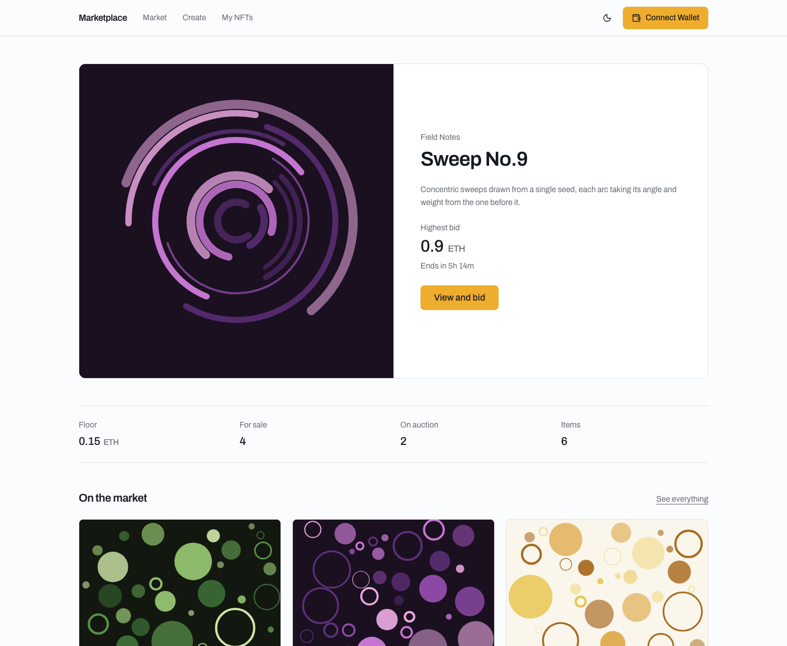
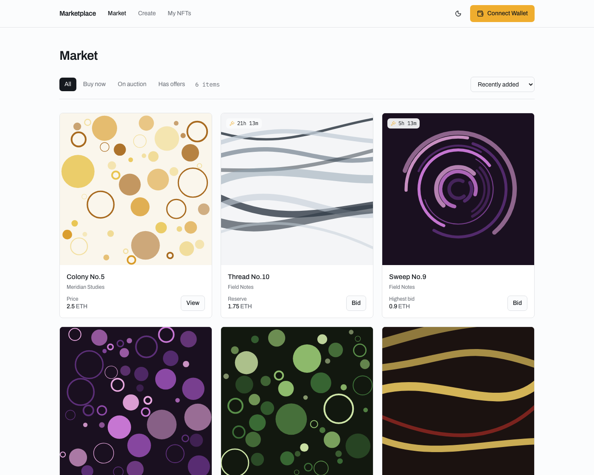
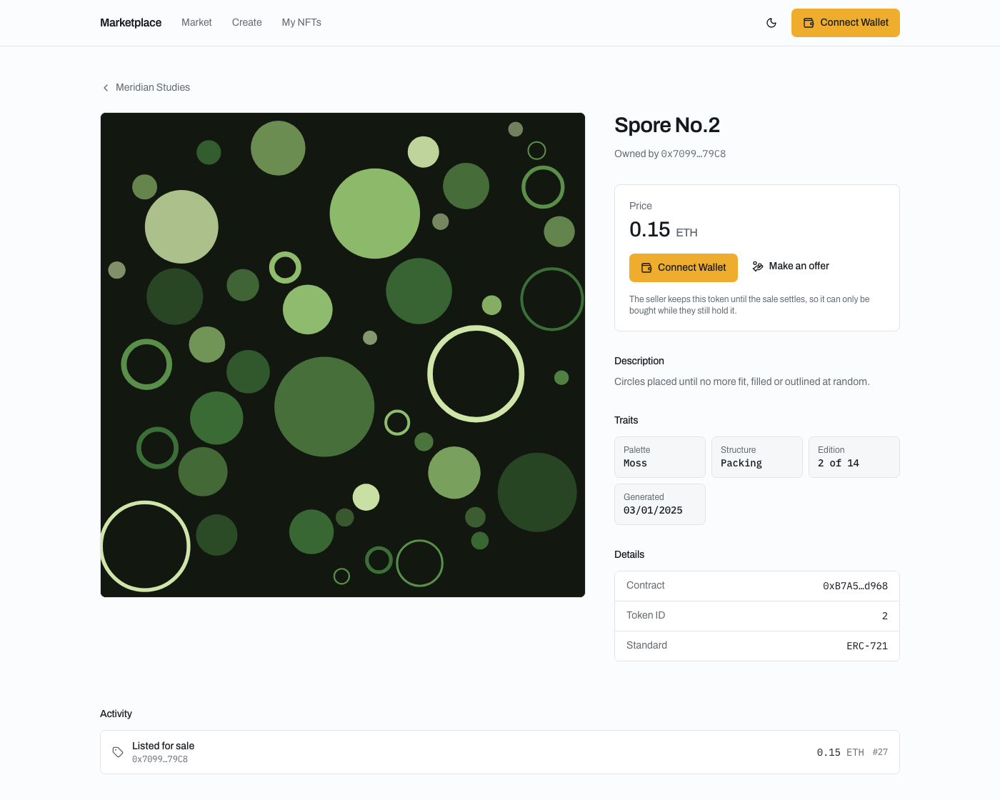

<div align="center">

# NFT Marketplace

**A marketplace where sellers keep their own keys — and their own contract.**

Deploy your own ERC-721, mint into it, and list on your terms. Your token stays
in your wallet until it actually sells.

[](https://github.com/ac12644/NFT-Marketplace/actions/workflows/ci.yml)
[](#testing)
[](https://github.com/ac12644/NFT-Marketplace/stargazers)
[](https://github.com/ac12644/NFT-Marketplace/network/members)
[](https://github.com/ac12644/NFT-Marketplace/issues)
[](LICENSE)

[](contracts/src)
[](https://docs.openzeppelin.com/contracts/5.x/)
[](https://nextjs.org)
[](https://wagmi.sh)
[](https://amoy.polygonscan.com)

[Quick start](#quick-start) · [Architecture](#architecture) · [Contracts](#contracts) · [Deploying](#deploying) · [Integrating](#connecting-to-the-marketplace) · [Contributing](#contributing)

</div>

<br />



<br />

## What this is

An NFT marketplace on Polygon Amoy, built end to end: a collection factory, a
marketplace that trades **any** ERC-721 or ERC-1155, and a Next.js frontend.

It is a portfolio-grade project, not a product. Everything runs on a testnet,
and the contracts have **not been audited**.

|                         |                                                                                                                              |
| ----------------------- | ---------------------------------------------------------------------------------------------------------------------------- |
| **Create collections**  | Anyone can deploy their own ERC-721 as an EIP-1167 minimal proxy — a fraction of a full deployment's gas, and yours outright |
| **Sell without escrow** | Fixed-price listings are approval-based, so the token never leaves your wallet until the sale settles                        |
| **Offers**              | Bid on anything, listed or not. Funds escrow until the owner accepts, you cancel, or it expires                              |
| **Auctions**            | Reserve price, pull-payment refunds for outbid bidders, and anti-sniping — a late bid extends the clock                      |
| **Royalties**           | ERC-2981, read defensively and capped, so a hostile collection can't claim the whole sale                                    |
| **Pull payments**       | Proceeds, royalties and refunds are *claimed*, never pushed. No counterparty can block a trade by reverting                  |

<br />

## Screenshots

<table>
<tr>
<td width="50%"></td>
<td width="50%"></td>
</tr>
<tr>
<td><b>Market</b><br />Filter by buy-now, auction or has-offers; sort by price.</td>
<td><b>Item</b><br />Traits, contract details, and the token's full on-chain history.</td>
</tr>
<tr>
<td colspan="2"></td>
</tr>
<tr>
<td colspan="2"><b>Collection</b><br />Banner, avatar and description come from ERC-7572 <code>contractURI()</code> — the same JSON OpenSea reads.</td>
</tr>
</table>

<br />

## Quick start

No testnet funds, no RPC key, no Pinata account. Three commands and you have a
marketplace full of data.

```sh
pnpm install
pnpm node      # terminal 1 — a local chain on 127.0.0.1:8545
pnpm seed      # terminal 2 — deploys everything and fills the market
pnpm dev       # http://localhost:3000
```

`pnpm seed` deploys the contracts, creates three collections, mints fourteen
generated pieces with full OpenSea metadata, then leaves the market with live
listings, two auctions (one already contested), standing offers, two completed
sales and a cancelled listing — so the activity feed and every price path have
something real to show. It writes `web/.env.local` for you.

The artwork is generated deterministically by `pnpm art`: five structural
styles across six palettes, written as SVG. Nothing is fetched from a
placeholder service, so the same seed always produces the same pieces.

To transact, add the Hardhat network (chain id **31337**, `http://127.0.0.1:8545`)
to your wallet and import one of the test accounts the seed prints.

> **Requires** Node 24 and pnpm 10. The Node version is pinned in
> `pnpm-workspace.yaml`, so pnpm fetches it for you.

<br />

## Architecture

```
contracts/          Hardhat 3 — Solidity 0.8.37, OpenZeppelin v5
  src/              Marketplace, MarketplaceCollection, CollectionFactory
  test/             109 tests: TypeScript + Solidity fuzz and invariants
  scripts/          seed, art generation, slither
web/                Next.js 16 App Router — Vercel's root directory
  app/              routes, including the upload API
  hooks/            wagmi + react-query data layer
  lib/              chain config, generated ABIs, event readers
```

| Layer        | Choice                                       |
| ------------ | -------------------------------------------- |
| Contracts    | Solidity 0.8.37, OpenZeppelin 5.6, Hardhat 3 |
| Chain        | Polygon Amoy                                 |
| Frontend     | Next.js 16, React 19, TypeScript             |
| UI           | Tailwind v4, Archivo + IBM Plex Mono         |
| Chain client | wagmi v3, viem 2                             |
| Storage      | Pinata (IPFS)                                |

**No wallet kit.** wagmi v3 already ships EIP-6963 discovery, WalletConnect and
Coinbase connectors, so the connect UI is ~60 lines built from the same
primitives as the rest of the app. RainbowKit still peer-requires wagmi v2.

<br />

## Contracts

Three, deliberately independent. The marketplace has no minting and no
privileged knowledge of any collection; collections have never heard of the
marketplace.

### `CollectionFactory`

`create(name, symbol, contractURI)` clones the collection implementation via
EIP-1167 and hands ownership to the caller.

`setImplementation` points **future** collections at new logic — existing ones
are frozen, because a minimal proxy hard-codes its implementation in its own
runtime bytecode. That is why this uses clones rather than a beacon: a beacon
would let the owner rewrite every collection users already own.

### `MarketplaceCollection`

ERC-721 + URIStorage + ERC-2981. Open minting; the minter becomes the royalty
receiver, capped at 10%. Written for cloning, so setup happens in `initialize`.

### `Marketplace`

| Function                                                    |                                                                                                    |
| ----------------------------------------------------------- | -------------------------------------------------------------------------------------------------- |
| `list` / `buy` / `cancelListing`                            | Fixed-price, approval-based. `buy` takes the expected terms, so a re-price in front of you reverts |
| `makeOffer` / `acceptOffer` / `cancelOffer`                 | Escrowed offers on any token                                                                       |
| `createAuction` / `bid` / `settleAuction` / `cancelAuction` | English auctions, escrowed                                                                         |
| `withdraw(token)`                                           | Claim proceeds, royalties and refunds                                                              |
| `setFee` / `setPayToken` / `pause`                          | Role-gated admin                                                                                   |

Upgradeable via UUPS behind an ERC-1967 proxy. `UPGRADER_ROLE` is held by a
`TimelockController` and **administers itself** — without that,
`DEFAULT_ADMIN_ROLE` administers every role by default and the admin key could
grant itself the upgrade permission, making the timelock decorative.

Pause blocks entry paths only: `cancelListing`, `cancelOffer`, `settleAuction`
and `withdraw` keep working, so nobody is ever trapped.

<br />

## Deploying

The local flow above needs nothing. Deploying to Amoy needs an RPC endpoint, a
funded key, and about two minutes.

### 1. Secrets

Hardhat 3 encrypts secrets at rest, so use the keystore rather than a `.env`:

```sh
cd contracts
npx hardhat keystore set AMOY_RPC_URL          # Alchemy, dRPC, or similar
npx hardhat keystore set DEPLOYER_PRIVATE_KEY
npx hardhat keystore set ETHERSCAN_API_KEY     # for source verification
```

Fund the deployer from the [Polygon faucet](https://faucet.polygon.technology/).

### 2. Deploy

```sh
pnpm deploy:amoy
```

That deploys, in one Ignition module:

|                       |                                                                    |
| --------------------- | ------------------------------------------------------------------ |
| `CollectionFactory`   | Which deploys the collection implementation in its own constructor |
| `MarketplaceTimelock` | Holds `UPGRADER_ROLE`; 48-hour delay by default                    |
| `Marketplace`         | The implementation                                                 |
| `MarketplaceProxy`    | The ERC-1967 proxy, initialised in the same transaction            |

**The proxy address is the marketplace.** All state lives there; the
implementation only supplies logic.

### 3. Override the defaults

Every parameter has a sensible default, but the ones that matter in production
do not stay sensible for long. Create `ignition/params.json`:

```json
{
  "MarketplaceModule": {
    "admin": "0xYourMultisig",
    "feeRecipient": "0xYourTreasury",
    "feeBps": 250,
    "minDelay": 172800,
    "proposers": ["0xYourMultisig"],
    "executors": ["0x0000000000000000000000000000000000000000"]
  }
}
```

```sh
pnpm --filter contracts exec hardhat ignition deploy   ignition/modules/Marketplace.ts --network amoy   --parameters ignition/params.json
```

Two defaults are deliberate and worth keeping:

- **`executors` is the zero address**, which means *anyone* may execute a
  scheduled upgrade once the delay is up. A single key cannot sit on an
  approved change.
- **The timelock has no admin.** It governs itself, so adding a proposer or
  shortening the delay has to go through the timelock and wait out the same
  delay. Handing that role to an EOA makes the whole timelock decorative.

### 4. Verify the source

```sh
pnpm --filter contracts verify:amoy
```

### 5. Point the app at it

Ignition prints the deployed addresses; they are also in
`contracts/ignition/deployments/chain-80002/deployed_addresses.json`. Copy them
into `web/.env.local`:

```sh
NEXT_PUBLIC_MARKETPLACE_ADDRESS=   # the PROXY, not the implementation
NEXT_PUBLIC_FACTORY_ADDRESS=
NEXT_PUBLIC_DEPLOY_BLOCK=          # block the deploy landed in
NEXT_PUBLIC_RPC_URL=
PINATA_JWT=                        # server only
```

`NEXT_PUBLIC_DEPLOY_BLOCK` is the floor for event queries. Leaving it at `0`
works but scans the whole chain from genesis on every load.

### 6. Accept an ERC-20 as payment

Native currency works out of the box. Anything else has to be allowlisted,
which is what makes fee-on-transfer and rebasing tokens a non-issue:

```solidity
marketplace.setPayToken(WETH, true);   // DEFAULT_ADMIN_ROLE
```

<br />

## Connecting to the marketplace

### From a wallet

The app handles this — connect, and if you are on the wrong network it offers
to switch. Manually: **Polygon Amoy**, chain id **80002**, currency **POL**.
For the local chain, **31337** at `http://127.0.0.1:8545`.

### From your own contract or script

The marketplace trades **any** ERC-721 or ERC-1155 — it detects the standard
via `supportsInterface` and stores it, so your collection does not have to know
the marketplace exists. Nothing needs deploying through the factory.

Listing is two steps: approve once, then list.

```ts
import { createWalletClient, custom, parseEther } from 'viem';
import { polygonAmoy } from 'viem/chains';

// 1. Let the marketplace move tokens from this collection. Once per
//    collection, not per token — the token stays in your wallet either way.
await wallet.writeContract({
  address: myCollection,
  abi: erc721Abi,
  functionName: 'setApprovalForAll',
  args: [MARKETPLACE, true],
});

// 2. List it. `amount` is 1 for ERC-721; `payToken` is the zero address for
//    native currency, or any allowlisted ERC-20.
await wallet.writeContract({
  address: MARKETPLACE,
  abi: marketplaceAbi,
  functionName: 'list',
  args: [
    myCollection,
    tokenId,
    1n,
    '0x0000000000000000000000000000000000000000',
    parseEther('1.5'),
    BigInt(Math.floor(Date.now() / 1000) + 30 * 24 * 3600),
  ],
});
```

Buying passes the terms you saw, so a seller re-pricing in front of you reverts
rather than charging more:

```ts
await wallet.writeContract({
  address: MARKETPLACE,
  abi: marketplaceAbi,
  functionName: 'buy',
  args: [listingId, expectedPrice, expectedPayToken],
  value: expectedPrice,          // omit when paying in an ERC-20
});
```

**Money is never pushed.** Proceeds, royalties and outbid refunds are credited
to `pending[account][token]` and claimed:

```ts
await wallet.writeContract({
  address: MARKETPLACE,
  abi: marketplaceAbi,
  functionName: 'withdraw',
  args: ['0x0000000000000000000000000000000000000000'],
});
```

### Reading the market

Every order event is indexed by `(orderId, collection, tokenId)`, so a node can
filter by topic and hand back exactly one token's history — no fetching the
whole log and discarding most of it:

```ts
const history = await publicClient.getContractEvents({
  address: MARKETPLACE,
  abi: marketplaceAbi,
  eventName: 'Sold',
  args: { collection, tokenId },
  fromBlock: DEPLOY_BLOCK,
});
```

Terminal events carry enough to be consumed standalone — `Sold` names the
asset, both parties, the amount, the currency and the fee, so you never have to
join back to `Listed` to learn what was traded.

Current state comes from the public getters: `listings(id)`, `auctions(id)`,
`offers(id)`, `pending(account, token)`.

| Event                                                                                      | Fires on                                          |
| ------------------------------------------------------------------------------------------ | ------------------------------------------------- |
| `Listed` / `ListingCancelled` / `Sold`                                                     | Fixed-price listings                              |
| `OfferMade` / `OfferCancelled` / `OfferAccepted`                                           | Offers                                            |
| `AuctionCreated` / `BidPlaced` / `AuctionExtended` / `AuctionSettled` / `AuctionCancelled` | Auctions                                          |
| `RoyaltyPaid` / `Withdrawn`                                                                | Payouts                                           |
| `CollectionCreated`                                                                        | On the factory, when someone deploys a collection |

<br />

## Testing

```sh
pnpm test                          # 109 tests
./contracts/scripts/slither.sh     # static analysis
```

|                           |                                                                                                                                                                      |
| ------------------------- | -------------------------------------------------------------------------------------------------------------------------------------------------------------------- |
| **101 TypeScript tests**  | Every path and every revert by custom error name, plus adversarial cases: reentrancy, hostile `royaltyInfo`, auction griefing, upgrade authorisation, storage layout |
| **5 Solidity fuzz tests** | 256 runs each — value conservation across any price/fee/royalty, fee caps, exact withdrawals, bid minimums                                                           |
| **3 Solidity invariants** | 256 randomised operation sequences: always solvent for what it owes, holds exactly `pending + escrow`, never holds more tokens than exist                            |

The invariants run against a handler that fires list/buy/offer/bid/settle/withdraw
in arbitrary order. Deliberately breaking the accounting makes
`invariant_exactAccounting` fail, so the check is known to bite rather than
passing vacuously.

Storage-layout tests compare solc's own output between versions and fail on a
reorder, removal, narrowed type or changed struct — with five negative tests
proving the check works.

CI runs contracts, static analysis and the web build on every push.

<br />

## Environment

| Variable                                                    | Where                | Purpose                                                       |
| ----------------------------------------------------------- | -------------------- | ------------------------------------------------------------- |
| `NEXT_PUBLIC_MARKETPLACE_ADDRESS`                           | web                  | Marketplace **proxy** address                                 |
| `NEXT_PUBLIC_FACTORY_ADDRESS`                               | web                  | Collection factory                                            |
| `NEXT_PUBLIC_DEPLOY_BLOCK`                                  | web                  | Floor for event queries                                       |
| `NEXT_PUBLIC_RPC_URL`                                       | web                  | Use Alchemy/dRPC — public endpoints rate-limit event queries  |
| `PINATA_JWT`                                                | web, **server only** | Pinning. Never prefix with `NEXT_PUBLIC_`                     |
| `AMOY_RPC_URL`, `DEPLOYER_PRIVATE_KEY`, `ETHERSCAN_API_KEY` | contracts            | Deploys and verification. Set with `npx hardhat keystore set` |

Uploads go through `web/app/api/upload/route.ts` so the Pinata credential stays
on the server. The route validates type and size and throttles per IP.

<br />

## Metadata

Token and collection metadata follow the
[OpenSea standard](https://docs.opensea.io/docs/media-and-traits) exactly, and
traits are validated server-side rather than passed through:

| Rule                                             | Enforced                       |
| ------------------------------------------------ | ------------------------------ |
| `display_type` requires an **unquoted number**   | `"40"` rejected, `40` accepted |
| `max_value` only with `display_type: "number"`   | rejected otherwise             |
| A value cannot exceed its `max_value`            | rejected                       |
| `background_color` is six hex characters, no `#` | `#FFD700` rejected             |

Collection metadata implements [ERC-7572](https://eips.ethereum.org/EIPS/eip-7572);
minting emits ERC-4906 `MetadataUpdate`.

<br />

## Contributing

Contributions are welcome. The local seed means you can be looking at a working
marketplace within a minute of cloning.

**Before opening a PR**

```sh
pnpm compile && pnpm test && pnpm typecheck && pnpm build
./contracts/scripts/slither.sh
```

**House rules**

- Contract changes need tests, and adversarial ones where money moves. A test
  that cannot fail is worse than no test — prove it bites.
- Storage layout is append-only. The layout tests will tell you if you broke it.
- Events stay self-describing: every order event is indexed by
  `(orderId, collection, tokenId)` and carries enough data to be consumed
  without joining back to its creation event.
- Never push value transfers on a trade path. Credit `pending` and let people
  withdraw.
- Run `pnpm abi` after changing a contract — the frontend's typed ABIs are
  generated.

### Known issues — good places to start

| Issue                                           | Notes                                                                                                                                                                       |
| ----------------------------------------------- | --------------------------------------------------------------------------------------------------------------------------------------------------------------------------- |
| **Horizontal overflow below 640px**             | Real and reproducible. Not the dev overlay (production behaves the same), not the headless renderer, not the toast container, not the header row. Layout is clean at ≥640px |
| **One hydration warning per page**              | A `Countdown` mismatch was found and fixed; a second remains. Not `next-themes` placement, not sonner's theme                                                               |
| **No EIP-712 signed orders**                    | Listings are on-chain by choice — smaller audit surface. Off-chain orders would make listing gasless                                                                        |
| **`PAUSER_ROLE` / `FEE_MANAGER_ROLE` coverage** | Tests prove non-holders are rejected, never that a dedicated role-holder succeeds                                                                                           |

<br />

## Security

> **Not audited.** The tests and patterns here make this defensible, not safe.
> It is fine on a testnet. Get an independent audit before it handles real
> value — and note that upgradeability means whoever holds `UPGRADER_ROLE` can replace the logic holding escrowed NFTs and every pending balance. Put that role's proposer behind a multisig.

Specific mitigations, each with a test:

| Vector                             | Mitigation                                                  |
| ---------------------------------- | ----------------------------------------------------------- |
| Reentrancy via receiver hooks      | `ReentrancyGuardTransient` (EIP-1153) + CEI + pull payments |
| Seller re-prices in front of a buy | `buy` reverts on changed terms                              |
| Outbid bidder blocks settlement    | Refunds credited, never pushed                              |
| Auction sniping                    | A late bid extends the clock                                |
| Hostile `royaltyInfo`              | `try/catch` + clamped to 10%                                |
| Fee-on-transfer tokens             | Payment-token allowlist                                     |
| UUPS implementation hijack         | `_disableInitializers()` in the constructor                 |
| Admin bypassing the timelock       | `UPGRADER_ROLE` administers itself                          |

<br />

## License

MIT — see [LICENSE](LICENSE).
